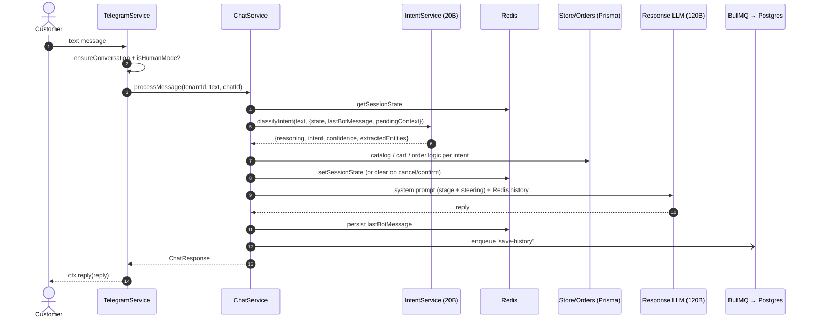

# Omnichannel Commerce AI — Execution Flow

NestJS backend (`apps/server`) + React admin dashboard (`apps/admin`). Intent resolution is **100% LLM-driven** (no regex/keyword fast-paths): `openai/gpt-oss-20b` classifies, `openai/gpt-oss-120b` writes the reply.

---

## 1. System Flow

```
Channel (Telegram / Web API / Admin)
   │
   ▼
Transport Adapter ── TelegramController → TelegramService   |  ChatController
   │                                     (human-mode guard)
   ▼
Unified Chat Orchestrator ── ChatService.processMessage
   │
   ▼
Intent Reasoning (Groq 20B) ── IntentService.classifyIntent
   │
   ▼
State / Context (Redis) ── RedisService.get/setSessionState  (ChatStage + cart + draftOrder + lastBotMessage)
   │
   ▼
Domain Execution ── ChatService.handleSessionAndContext
   │                 ├─ IStoreProvider (LocalDbStoreProvider → VectorSearchService → pgvector / Prisma)
   │                 └─ OrdersService.create (Prisma)
   ▼
Response Generation (Groq 120B) ── buildStageAwareSystemPrompt → RunnableWithMessageHistory → LlmService.getResponseModel
   │
   ▼
Channel Reply ── ctx.reply (Telegram) / HTTP JSON    ⇢ BullMQ 'chat-persistence' → Postgres (async)
```



---

## 2. End-to-End Pipeline (function by function)

| # | Layer | Class → Method | What happens |
| :-: | :--- | :--- | :--- |
| 1 | Transport | `TelegramController.handleWebhook` → `TelegramService.handleWebhookUpdate` (or long-polling `bot.launch`) | Validates `x-telegram-bot-api-secret-token` (`isValidWebhookSecret`), hands the `Update` to Telegraf. `registerHandlers` routes `/start`, `/cancel` and `message('text')` to `processAndReply(ctx, chat.id, text)`; `chat.id` = `conversationId`. |
| 1b | Transport (web) | `ChatController.handleChat` (`POST /api/chat`, `/api/v1/chat`) | Body `ChatRequestDto{tenantId,message,conversationId}` → `ChatService.processMessage` directly (no human-mode guard). |
| 2 | Session & Guard | `TelegramService.processAndReply` → `ConversationsService.ensureConversation`, `isHumanMode` | Upserts tenant/conversation row; reads `isHumanMode` from the Redis session (DB fallback). If `true`: store the USER message via `saveMessages` and **return** (LLM bypassed). |
| 3 | Session | `ChatService.processMessage` → `RedisService.getSessionState` | Loads `UserSessionState` (`stage: IDLE \| COLLECTING_USER_INFO \| CONFIRMING_ORDER`, `cart`, `draftOrder`, `lastAction`, `lastViewedProduct`, `lastBotMessage`). |
| 4 | Intent (Groq 20B) | `IntentService.classifyIntent(msg, IntentContext)` | Builds `pendingContext` (cart, missing checkout fields, product in view), injects `currentState` + `lastBotMessage`, calls `LlmService.getIntentModel()` (JSON mode). `parseIntentResponse` → `IntentResult{intent, confidence, extracted_query, extracted_info, reasoning}`. Any failure → `UNKNOWN` (state preserved). |
| 5 | Domain & State Machine | `ChatService.handleSessionAndContext` | Per intent: `CANCEL_ORDER` → reset session; `ADD_TO_CART` → `storeProvider.getProductList` + cart push → `COLLECTING_USER_INFO`; `COLLECT_INFO` → merge name/phone/address, all 3 present → `CONFIRMING_ORDER`; `CONFIRM_ORDER` (only in `CONFIRMING_ORDER`) → `OrdersService.create`, clear session; `QUERY_PRODUCT` / `GENERAL_CATALOG_QUERY` → `getProductList`; `CHECK_ORDER` → `getOrderSummary`. `CHIT_CHAT`/`UNKNOWN` never change stage or anchor. |
| 6 | Data access | `LocalDbStoreProvider.getProductList` → `VectorSearchService.searchSimilarProducts` → `EmbeddingsService` | Redis-cached (5 min); pgvector cosine search (≥ 0.3) with SQL `LIKE` fallback. |
| 7 | Response & Steering (Groq 120B) | `buildStageAwareSystemPrompt` → `ChatService.createHistoryRunnable` (`RunnableWithMessageHistory` + `RedisChatMessageHistory`) → `LlmService.getResponseModel()` | Stage/intent-specific prompt. For `CHIT_CHAT`/`UNKNOWN`, `buildSteeringBlock` adds: acknowledge in one friendly sentence, then re-anchor to the current stage using the pending cart, missing fields and `lastBotMessage`. |
| 8 | Persistence | `ChatService.processMessage` → `RedisService.setSessionState`; `chatPersistenceQueue.add('save-history')` | Stores `lastBotMessage` in the session; enqueues async DB write. |
| 9 | Worker | `ChatPersistenceProcessor.process` → `ConversationsService.saveMessages` → `ConversationEventsService.publish` | Writes USER + ASSISTANT rows, updates preview/unread, pushes live event to the dashboard SSE. |
| 10 | Dispatch | `TelegramService.processAndReply` → `ctx.reply(reply)` | Sends `ChatResponse.reply` to the customer. Errors → generic apology reply. |

---

## 3. Admin Human Takeover (bypass path)

```
Admin Dashboard ─ PATCH /api/v1/admin/conversations/:id/toggle-mode ─▶ AdminController.toggleMode → ConversationsService.setHumanMode (Redis + DB, SSE 'mode' event)
Customer msg  ─▶ TelegramService.processAndReply: isHumanMode === true → saveMessages(USER) → STOP (no Intent/LLM)
Admin reply   ─ POST /api/v1/admin/conversations/:id/reply ─▶ AdminController.reply → TelegramService.sendMessage → saveMessages(AGENT)
```

Switching back to AI clears the cached Redis LLM history so it is rebuilt from the DB (includes the human's messages).

---

## 4. Directory & Component Map (`apps/server/src`)

| File | Responsibility |
| :--- | :--- |
| `main.ts`, `app.module.ts` | Bootstrap and root module wiring. |
| `config/configuration.ts`, `env.validation.ts` | Env-driven config + validation. |
| `telegram/telegram.controller.ts` | Webhook endpoint with secret check. |
| `telegram/telegram.service.ts` | Telegraf bot, human-mode guard, reply dispatch, `sendMessage` for admins. |
| `chat/chat.controller.ts` | REST chat endpoint(s). |
| `chat/chat.service.ts` | Orchestrator: intent → state machine → domain → response → persistence. |
| `chat/intent.service.ts` | Context-first LLM intent classifier (Groq 20B). |
| `chat/chat-response.prompt.ts` | Stage-aware system prompts and chit-chat re-anchoring (Groq 120B). |
| `chat/llm.service.ts` | Groq model factory (`gpt-oss-20b` intent, `gpt-oss-120b` response). |
| `chat/language-policy.ts` | English-only instruction shared by both prompts. |
| `chat/vector-search.service.ts`, `embeddings.service.ts` | pgvector semantic product search and local embeddings. |
| `chat/dto/chat-request.dto.ts` | Validated chat request payload. |
| `chat/tests/context-steering.spec.ts` | Jest suite: pure-LLM intent pipeline and re-anchoring (mocked Groq). |
| `redis/redis.service.ts` | Redis client wrapper; session state get/set/clear. |
| `redis/session-state.ts` | `ChatStage`, `UserSessionState`, cart/draft types. |
| `redis/redis-chat-history.ts` | LangChain chat history in Redis with DB rehydration. |
| `products/interfaces/store-provider.interface.ts` | `IStoreProvider` contract and product/order view types. |
| `products/providers/local-db-store.provider.ts` | Prisma + vector catalog/order lookups with Redis cache. |
| `products/products.service.ts`, `products.controller.ts` | Product CRUD and public listing. |
| `orders/orders.service.ts`, `orders.controller.ts` | Order creation, listing, status updates. |
| `conversations/conversations.service.ts` | Conversation rows, human-mode toggle, message persistence. |
| `conversations/conversation-events.service.ts` | RxJS event bus feeding the admin SSE stream. |
| `conversations/queue/chat-persistence.processor.ts` | BullMQ worker persisting chat turns. |
| `admin/admin.controller.ts`, `dto/admin.dto.ts` | JWT-guarded dashboard API (products, orders, conversations, takeover). |
| `auth/*` | JWT login and `JwtAuthGuard`. |
| `database/prisma.service.ts` | Prisma client lifecycle. |

---

## 5. Commands

```bash
npm run build:server              # nest build
cd apps/server && npx tsc --noEmit
cd apps/server && npx jest src/chat/tests/context-steering.spec.ts
```
